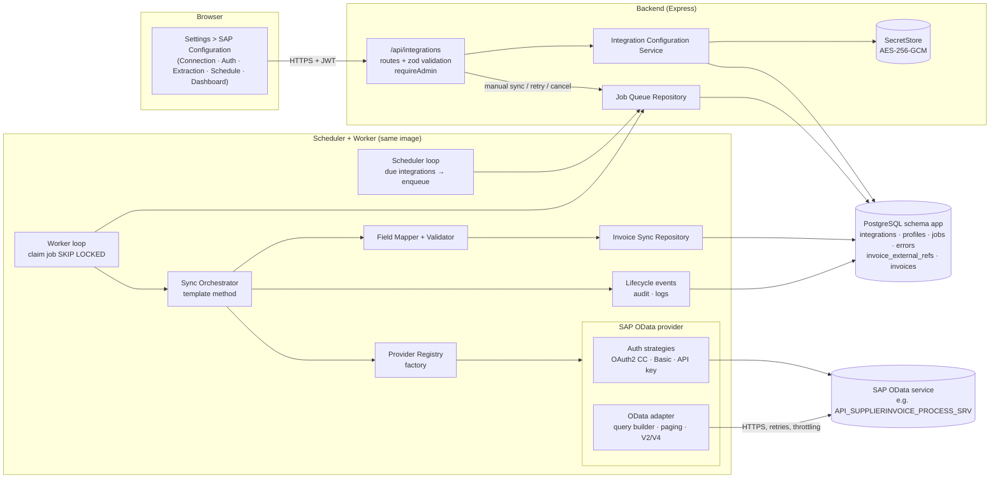
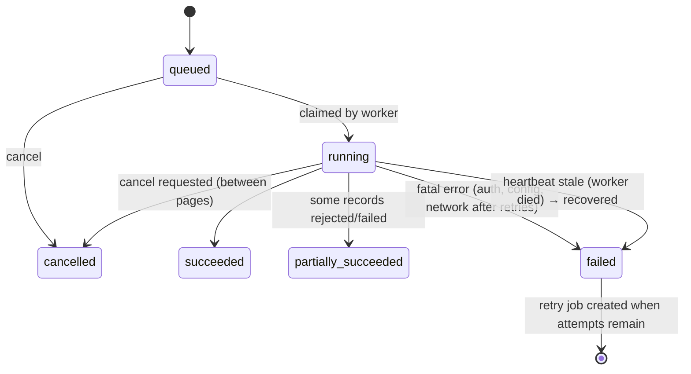
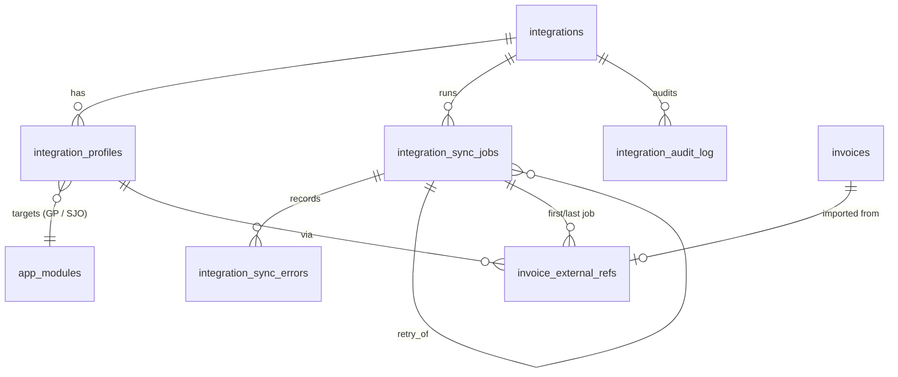

# Invoice Integrations (SAP OData first) – Architecture & Design

Status: **implemented** (see [OPERATIONS.md](OPERATIONS.md) and [ADDING_A_PROVIDER.md](ADDING_A_PROVIDER.md)) · Scope: backend (`backend/src/integrations`, `backend/src/modules/integrations`),
database (`database/postgres`), frontend (`Settings > SAP Configuration`).

---

## 1. Existing application (as analysed)

| Area | What exists today | Consequence for this feature |
|---|---|---|
| Frontend | React 19 + Vite, react-router 7, axios `apiClient` (`/api`, 5 s timeout), `LanguageContext` (en/es), plain CSS theme | New screens follow `pages/settings/*` patterns (Modal, ConfirmDialog, Pager, badges, toasts) |
| Backend | Express 5 + TypeScript (NodeNext), zod validation (`utils/validate.parse`), `HttpError`, JWT `authenticate`, `requireAdmin` | New module `modules/integrations` mounted at `/api/integrations`, admin-only |
| Data access | PostgreSQL (Supabase), schema `app`; **all access through `app.usp_*` functions** returning `app.udt_*` composite types; errors `CA400/CA404/CA409` → HTTP | Integration persistence follows the same function + type convention |
| Invoice model | `app.invoices` (module → application GP / sjo / rospbu), vendor by **CUIT** (unique), status from `app.statuses`, workflow fields (team, assigned user, process) | SAP invoices land in the same table, targeted at a GP or SJO module; workflow fields are never overwritten by sync |
| Invoice creation | `usp_invoice_create_batch` (all-or-nothing, daily `max_invoices_limit`) | Sync uses a dedicated idempotent upsert function instead (row-level outcomes, no daily UI limit) |
| Background jobs | **None** (no queue, scheduler, Redis) | See §3 – PostgreSQL-backed queue + in-process worker; no new infrastructure |
| Logging / monitoring | `console` + `morgan` | Small structured JSON logger with secret redaction; job metrics in the database |
| Tests | **None** | Node's built-in `node:test` runner via `tsx` (no new framework) |
| Deployment | Docker images (node:22-alpine, nginx), docker-compose | Worker runs inside the API container by default; can be split into its own container (same image, `npm run worker`) |

## 2. Goals and non-goals

Goals: provider-independent invoice synchronization framework; SAP OData (V2 and V4) as first provider;
scheduled + manual sync; idempotent, resumable, observable; secrets encrypted at rest and never returned.

Non-goals (v1): writing back to SAP; payment execution (the application routes invoices, it does not pay them);
detecting hard deletes in SAP (OData offers no delete feed without delta tokens – see §7).

## 3. Key decisions

| # | Decision | Why | Alternatives considered |
|---|---|---|---|
| D1 | **PostgreSQL job queue** (`integration_sync_jobs`) claimed with `FOR UPDATE SKIP LOCKED`; scheduler + worker loops run **in the API process** by default (`SYNC_WORKER_ENABLED`), or in a separate process with `npm run worker` | Postgres already exists; transactional with the data; no Redis to operate; scales to several workers safely | BullMQ (needs Redis), pg-boss (extra dependency + its own schema), cron in the container (no manual trigger / history) |
| D2 | **No overlapping jobs**: partial unique index – at most one `queued`/`running` job per integration; manual trigger while active → `409` | Enforced by the database, not by timing | Advisory locks only (lost on pooler reconnects) |
| D3 | **Secrets encrypted in the database** with AES-256-GCM, key from `INTEGRATION_SECRET_KEY` (env / container secret), behind a `SecretStore` interface | Works on Supabase and Docker today; a Key Vault store can be added without touching callers | Azure Key Vault now (no vault provisioned yet) |
| D4 | **Uniqueness**: `(source_system, external_key)` in `invoice_external_refs`; SAP key = `CompanyCode/FiscalYear/SupplierInvoice` (configurable) | Stable across re-syncs and integration re-creation; one SAP document never yields two invoices | Matching on invoice numbers (not unique across companies/years) |
| D5 | **Row-level outcomes**: each page is upserted by one function call; a bad row is rejected (savepoint), the rest of the page commits; the **watermark advances per page** | Partial failures never duplicate or lose work; re-runs are safe | Whole-job transaction (one bad row loses everything) |
| D6 | **Source-owned vs workflow fields**: updates only touch source fields (vendor, numbers, dates, amounts, currency); `status`, team, assigned user, process are never overwritten | Re-sync cannot reopen or re-route an invoice already being processed (no duplicate downstream work) | Full overwrite |
| D7 | **Extraction profiles**: one integration has N profiles, each targeting one app module (GP, SJO, …) with its own entity set, filters, mapping and cursor | General Payments and SJO extract different SAP documents, but share connection/auth | One integration per module (duplicates credentials) |
| D8 | Admin-only (`requireAdmin`) for viewing and changing integrations; secrets write-only | Matches the existing role model (Admin / User) | New permission model (not needed yet) |

## 4. Architecture



### Component responsibilities (SRP) and contracts (ISP / DIP)

| Component | Location | Responsibility | Depends on (abstraction) |
|---|---|---|---|
| Integration Configuration Service | `modules/integrations/integrations.service.ts` | CRUD, validation (provider schema), secret rotation, audit | `IntegrationRepository`, `SecretStore`, `ProviderRegistry` |
| Provider contract | `integrations/core/contracts.ts` | `IntegrationProvider` = `validateConfig` + `createAuth` + `createSource` + `testConnection` | – |
| Auth strategies (Strategy) | `integrations/core/auth/*` | Produce request headers; cache/refresh tokens; never log secrets | `HttpClient` |
| SAP OData adapter (Adapter) | `integrations/providers/sap-odata/*` | Build `$filter/$select/$expand/$orderby/$top/$skip`, follow `__next` / `@odata.nextLink`, normalise V2 `d.results` / V4 `value`, `$metadata` check | `HttpClient`, `AuthStrategy` |
| HTTP client | `integrations/core/http/http-client.ts` | Timeouts, retry with exponential backoff + jitter, `Retry-After` on 429/503, cancellation, HTTPS-only (certificate validation on) | – |
| Field Mapper + Validator | `integrations/core/mapping/*` | Config-driven mapping (paths, transforms) to the **canonical invoice**; zod validation | – |
| Sync Orchestrator (Template Method) | `integrations/core/sync/sync-orchestrator.ts` | Fixed workflow: load config → auth → per profile: extract page → map → validate → persist → checkpoint → metrics; cancellation between pages | `ProviderRegistry`, `InvoiceSyncRepository`, `JobRepository`, `SyncEvents` |
| Invoice Sync Repository (Repository) | `integrations/persistence/*` | Idempotent page upsert (`usp_integration_invoice_upsert`), cursor checkpoints, job metrics, errors | `callFunction` |
| Job queue / Scheduler / Worker | `integrations/jobs/*` | Enqueue (deduplicated), claim, heartbeat, stale-lock recovery, retries with backoff, next-run computation | `JobRepository` |
| Lifecycle events (Observer) | `integrations/core/events.ts` | `job.started/page.processed/job.finished/job.failed` → structured log + audit subscribers | – |
| Provider Registry (Factory) | `integrations/core/provider-registry.ts` | Map `provider_type` → provider; adding a provider = registering it | – |

Core business logic (GP / SJO workflow, invoice detail, team assignment) has **no dependency** on the
integration code; the only shared surface is the `app.invoices` table plus `invoice_external_refs`.

## 5. Synchronization flow

```mermaid
sequenceDiagram
  autonumber
  participant S as Scheduler / Admin
  participant Q as integration_sync_jobs
  participant W as Worker
  participant O as Orchestrator
  participant P as SAP OData provider
  participant SAP as SAP OData
  participant DB as usp_integration_invoice_upsert

  S->>Q: enqueue (unique: one active job per integration)
  W->>Q: claim (FOR UPDATE SKIP LOCKED) → running
  W->>O: run(job, AbortSignal)
  loop each active profile (GP, SJO, …)
    O->>P: extract(profile, since = watermark; provider re-reads its overlap window)
    loop each page ($top / next link)
      P->>SAP: GET EntitySet?$filter=...&$orderby=Changed asc,Key asc
      SAP-->>P: page (+ next link) — 429/5xx retried with backoff
      P-->>O: records
      O->>O: map → validate (rejects recorded)
      O->>DB: upsert page (row-level savepoints)
      DB-->>O: created / updated / unchanged / rejected per row
      O->>Q: checkpoint watermark + counters + heartbeat
      O->>Q: cancel requested? → stop safely
    end
  end
  O->>Q: finish (succeeded | partially_succeeded | failed | cancelled)
  Note over Q: failed + attempts left → new job queued at now + backoff(attempt)
```

### Job states



## 6. Database changes

New scripts (idempotent, through `deploy_schema.sql`): `tables/23_integrations.sql` …
`tables/28_integration_audit_log.sql`, response types `udt_integration_*`, functions under
`procedures/integrations/`.



| Table | Key columns |
|---|---|
| `integrations` | `provider_type`, `name` (unique), `description`, `environment`, `source_system` (stable id, e.g. `S4P-100`), `is_active`, `connection jsonb` (baseUrl, servicePath, odataVersion, apiVersion, timeoutMs, pageSize, maxRetries, minRequestIntervalMs, headers), `auth_type`, `auth_settings jsonb` (non-secret), `secret_ciphertext`, `secret_updated_at`, `schedule jsonb` (interval / daily / cron, timezone), `auto_sync_enabled`, `retry_policy jsonb`, `next_run_at`, `last_attempt_at`, `last_success_at`, `last_status`, `version` (optimistic concurrency) |
| `integration_profiles` | `integration_id`, `module_id` (GP / SJO module), `name`, `is_active`, `settings jsonb` (provider-specific; SAP: `entitySet`, `select`, `expand`, `filters`, `customFilter`, `orderBy`, `pageSize`, `incrementalField`, `incrementalFieldType`, `overlapMinutes`, `maxRecordsPerRun`), `initial_from`, `key_fields`, `invoice_code_template`, `field_mapping jsonb`, `cancellation_rule jsonb`, `default_status`, cursor: `watermark`, `watermark_updated_at` |
| `integration_sync_jobs` | `integration_id`, `trigger_type` (scheduled / manual / retry), `requested_by`, `status`, `attempt`, `max_attempts`, `retry_of_job_id`, `run_after`, `started_at`, `finished_at`, `heartbeat_at`, `worker_id`, `cancel_requested`, counters `records_fetched/created/updated/unchanged/rejected/failed`, `pages_processed`, `profile_stats jsonb`, `error_summary` · **partial unique index** `(integration_id) WHERE status IN ('queued','running')` |
| `integration_sync_errors` | `job_id`, `profile_id`, `external_key`, `stage` (fetch / mapping / validation / persistence / review), `message`, `details jsonb` (field names + sanitized values, never credentials) |
| `invoice_external_refs` | `invoice_id` (unique), `source_system`, `external_key`, **unique (source_system, external_key)**, `integration_id`, `profile_id`, `external_doc jsonb` (company code, fiscal year, doc no.), `source_changed_at`, `payload_hash`, `source_state` (active / cancelled), `first_job_id`, `last_job_id`, `first_synced_at`, `last_synced_at` |
| `integration_audit_log` | `integration_id`, `actor_user_id`, `action` (created, updated, secret_rotated, sync_requested, job_cancelled, job_retried, connection_tested, cursor_reset, deleted), `details jsonb` (changed field names only) |

Indexes: jobs `(integration_id, created_at DESC)`, `(status, run_after)` for claiming; errors `(job_id)`;
refs `(integration_id)`. **Retention**: `usp_integration_purge_history(p_keep_days)` (default 90 days,
`SYNC_HISTORY_RETENTION_DAYS`) run daily by the scheduler; refs are never purged (traceability).

## 7. Data integrity rules

| Rule | Behaviour |
|---|---|
| Uniqueness | `(source_system, external_key)`; key built from configurable `keyFields` (SAP default `CompanyCode`, `FiscalYear`, `SupplierInvoice`) |
| Invoice code | Template, default `INV-{prefix}-SAP-{SupplierInvoice}-{FiscalYear}` (≤ 60 chars, validated) |
| New record | Insert invoice (status = profile `defaultStatus`, default `Pending`), vendor by CUIT (created if missing), ref row with `first_job_id` |
| Changed record | `payload_hash` differs → update **source fields only**; counts as `updated`. Same hash → `unchanged` (skipped) |
| Cancelled / reversed | Cancellation rule (e.g. `ReverseDocument ne ''`): ref `source_state = cancelled`; invoice status set to the rule's status **only while the invoice is still in an allowed status** (default `Pending`); otherwise recorded as a `review` error for a human |
| Deleted in SAP | Not detectable through standard OData queries; documented limitation (can be added with a provider supporting deltas) |
| Mandatory fields | `externalKey`, `invoiceCode`, `vendorName`, `cuit`, `amount ≥ 0`, `receptionDate`; failures → `rejected` with field-level reason |
| Traceability | invoice → `invoice_external_refs` → profile / integration / first & last job → job errors |
| No duplicate downstream work | Single invoice per SAP document; updates never change status, team, assignee; cancellation never reopens |
| Transactions | One DB transaction per page (row savepoints); watermark + counters written in the same transaction as the page; a crash re-runs at most one page, which the upsert makes idempotent |
| Daily UI limit | `max_invoices_limit` applies to manual creation only, not to SAP sync (configurable later if required) |

## 8. API (all under `/api/integrations`, `Authorization: Bearer`, Admin only)

| Method & path | Purpose |
|---|---|
| `GET /providers` | Provider types, auth types, OData versions, schedule presets, SAP templates (GP / SJO) |
| `GET /?providerType=sap-odata` | List integrations with status summary |
| `POST /` | Create (connection, auth settings, optional secret, schedule, profiles) |
| `GET /:id` | Details – secrets reported only as `{ configured, updatedAt }` |
| `PUT /:id` | Update (requires `version`; `409` on concurrent edit); profiles upserted by id |
| `DELETE /:id` | Delete (refused while a job is running); imported invoices keep their refs |
| `PUT /:id/credentials` | Set / rotate secret (write-only) |
| `POST /:id/test-connection` | Auth + `$metadata` + entity set / mapped field check + 1-record probe; optional unsaved draft overrides |
| `POST /:id/sync` | Manual sync (`202` with job; `409` if one is queued/running) |
| `GET /:id/summary` | Dashboard: last job, last success/attempt, next run, 30-day totals |
| `GET /:id/jobs?status=&trigger=&from=&to=&page=&limit=` | Execution history |
| `GET /:id/jobs/:jobId` | Job detail incl. per-profile stats |
| `GET /:id/jobs/:jobId/errors?stage=&page=&limit=` | Error details |
| `POST /:id/jobs/:jobId/retry` | Re-run a failed / partially succeeded job |
| `POST /:id/jobs/:jobId/cancel` | Cancel a queued job or request safe stop of a running one |
| `POST /:id/profiles/:profileId/reset-cursor` | Full re-sync of one profile from `initialFrom` |

The OpenAPI document (`/api/docs`) is extended with these operations and schemas.

## 9. Frontend – Settings > SAP Configuration

Route `/settings/sap-configuration` (list) and `/settings/sap-configuration/:id/:tab`.

* **List**: integrations (name, environment, status badge, last sync, next run) + *New integration*.
* **Tabs** of one integration:
  1. **Connection** – name, description, environment, source system id, base URL, service path, OData version,
     API version, timeout, page size, max retries, request interval, extra headers, active toggle, *Test connection*.
  2. **Authentication** – method (OAuth 2.0 client credentials, Basic, API key / custom header, None for
     test systems); non-secret fields; secret fields are write-only (“•••• set on 21/10/2026 · Replace”).
  3. **Extraction** – profiles (General Payments, SJO …): target module, entity set, `$select`, `$expand`,
     `$filter`, `$orderby`, page size, incremental field + overlap, initial sync date, key fields,
     cancellation rule, default status, field-mapping table (internal field ⇄ SAP path + transform),
     *Load SAP template*, *Reset cursor*.
  4. **Schedule** – automatic sync toggle, frequency (15 min / hourly / daily at / custom cron), time zone,
     last success, last attempt, next run, current status, *Sync now*.
  5. **Dashboard & History** – KPI tiles (fetched, created, updated, skipped, rejected, failed, last duration),
     history table with status / trigger / date filters and paging, job detail drawer with per-profile
     stats and paged errors, *Retry* / *Cancel*.

Validation messages come from the API (`details.fieldErrors`) and are shown next to the fields.

## 10. Security

* HTTPS required for `baseUrl` and token URLs (http allowed only for `localhost` when `NODE_ENV != production`);
  Node's TLS certificate validation stays on; optional extra CA via `INTEGRATION_CA_FILE`.
* Secrets: AES-256-GCM (random IV, auth tag, key id prefix for rotation), decrypted only inside the worker /
  test-connection call; responses expose `configured` flags only; the logger redacts `authorization`,
  `password`, `secret`, `token`, `apiKey` keys and bearer values; error messages from SAP are truncated
  and stripped of echoed credentials.
* RBAC: `requireAdmin` on every route; audit log of who changed what (field names, never values).
* SSRF guard: only http(s) URLs, no credentials in URLs, configurable host allow-list
  (`INTEGRATION_ALLOWED_HOSTS`).

## 11. Testing strategy

`npm test` → `node --import tsx --test` (built-in runner, no new framework).

| Suite | Covers |
|---|---|
| unit/auth | OAuth2 token caching / expiry / 401 refresh, Basic, API key, secret never in errors |
| unit/http-client | timeout, retry/backoff, `Retry-After`, non-retryable 4xx, cancellation |
| unit/odata | V2/V4 query building, escaping, incremental filter, paging (`__next`, `@odata.nextLink`, `$skip`) |
| unit/mapping | paths, transforms, validation failures, invoice-code template |
| unit/orchestrator | idempotency, partial failures, checkpoints, cancellation, retries (in-memory repositories) |
| unit/secrets | encrypt/decrypt, tamper detection, redaction of responses and logs |
| unit/schedule, unit/worker-scheduler | next-run for interval / daily / cron in time zones (DST), retry backoff, worker retries, stale recovery, cancellation, overlap prevention |
| unit/extensibility | **a new provider and a new auth strategy registered without changing the core workflow**; configuration validation |
| integration/sap-odata | provider against a mock SAP OData server (paging, 429 throttling, auth failure, `$metadata`) |
| integration/api | router + admin guard + error handler with an in-memory repository: 401/403, secrets sealed and never returned / audited, validation field paths, 409s, connection test of unsaved values |
| e2e/regression | against a running API + DB (`E2E_API_URL`): GP / SJO regression, full SAP sync into both apps, idempotent re-run |
| db (psql) | upsert idempotency, row-level rejection, uniqueness, cancellation rule – inside `BEGIN … ROLLBACK` |

## 12. Implementation plan

1. Database scripts + functions (deploy is idempotent; no change to existing tables except new `invoice_external_refs`).
2. Core framework: contracts, HTTP client, auth strategies, mapping, secret store, logger, events.
3. SAP OData provider + templates; mock SAP OData server (`npm run mock:sap`) for local runs and tests.
4. Orchestrator, job repository, scheduler, worker (`SYNC_WORKER_ENABLED`, `npm run worker`).
5. REST module + OpenAPI.
6. Frontend module + translations.
7. Tests, docs (`ADDING_A_PROVIDER.md`, deployment/config), regression check of GP / SJO screens.

## 13. Second provider: Hyland OnBase (ECM)

`providers/onbase` adds OnBase without changing the orchestrator contract: a new auth strategy
(`hyland-idp-password`), an extractor (document queries by type + keywords, date windows split at
the result limit), a connection tester, templates, and the optional `DocumentFetcher` capability –
the orchestrator attaches the source file through an `AttachmentStore` port
(`persistence/fs-attachment-store.ts`, `usp_integration_invoices_without_attachment`). Details and
open questions: [ONBASE.md](ONBASE.md).

## 14. Assumptions & open questions

Assumptions are configuration, not code, so they can change without redeploying:

* SAP S/4HANA with the Supplier Invoice OData API (V2 `API_SUPPLIERINVOICE_PROCESS_SRV`, entity `A_SupplierInvoice`)
  is used as the **template**; field names must be confirmed against the customer’s `$metadata`
  (*Test connection* lists missing fields).
* The vendor CUIT comes from the supplier tax number (an `$expand` or a dedicated field); records without it are rejected.
* Each profile targets exactly one module; the split between General Payments and SJO is expressed with profile filters
  (e.g. company code, document type).

Open questions for the business / SAP team:

1. Which SAP system and OData service(s), OData version, and authentication method (and is there a test tenant)?
2. Which SAP attributes distinguish General Payments from SJO documents?
3. Which field holds the CUIT, and how are credit notes represented?
4. Expected handling of invoices reversed in SAP after processing started.
5. Expected volumes per day (sizing of page size / frequency) and SAP rate limits.
